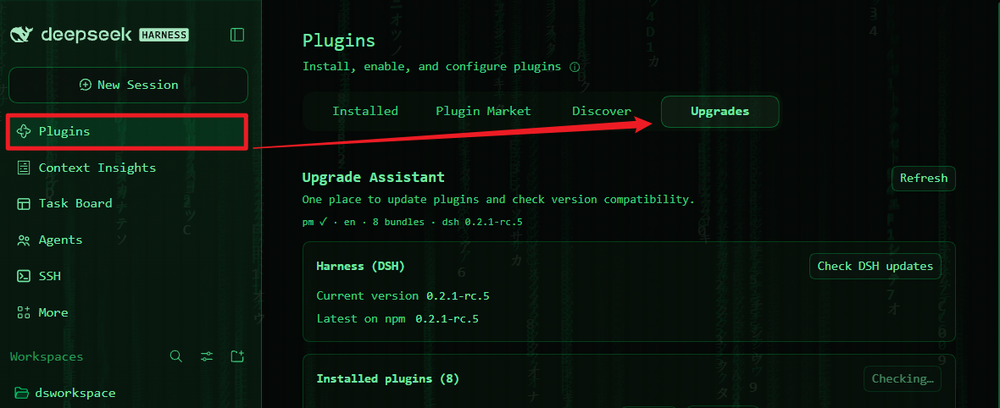

# Upgrade Assistant (dsh-upgrade-assistant)

**English** | [简体中文](./README.zh-CN.md)

A [DeepSeek Harness (DSH)](https://github.com/deepseek-ai/deepseek-harness) plugin that adds an
**"Upgrades" tab** to the Plugins page: update checks for every installed plugin, DSH-compatibility
preflight, and one-click in-place upgrades — with every failure explained in plain language.



```
pm ✓ · en · 8 bundles · dsh 0.2.1-rc.5        ← self-diagnostics strip
┌ Harness (DSH) ── Current version / Latest on npm [Check DSH updates]
├ Installed plugins (N) ── [Check plugin updates]
│   Context (dsh-context)  0.77.0 → 0.78.1  [Upgrade available]      engines.dsh: …
│   Claude Code subagent   0.2.1-rc.2       [Official] [Up to date]
│   dsh-web 0.4.7                           [Not on npm — skipped] [Refresh bundled family]
├ Version exemptions — which "skip the DSH gate" permits are active
└ When an upgrade fails — the four common failure classes, decoded
```

## Install

From GitHub (recommended):

```
dsh plugin --profile <your-profile> add github:zhangrui824/dsh-upgrade-assistant
```

Or from a local clone:

```
git clone https://github.com/zhangrui824/dsh-upgrade-assistant.git
dsh plugin --profile <your-profile> add file:/absolute/path/to/dsh-upgrade-assistant
```

## Usage

1. Sidebar → **Plugins** → the **Upgrades** tab
2. **Check plugin updates**: compares each installed bundle against npm (profile mirror aware,
   5-minute cache, concurrency 3)
3. Green **Upgrade available** → click **Upgrade** (inline confirm, then it runs);
   yellow **Needs newer DSH** → upgrade DSH first — the button is hidden because the attempt
   would certainly fail
4. **Check DSH updates**: compares the running Harness against the newest npm release

### How the updates actually work

- **npm-installed plugins**: in-place `pnpm update --latest --config.minimumReleaseAge=0 <name>`.
  The `minimumReleaseAge=0` override skips pnpm's 24-hour release-cooling gate (the classic
  "version is too new to install" failure); this only happens on your explicit click.
- **Transitive families** (npm dependencies pulled in by GitHub-sourced bundles such as the
  dsh-web family): `pnpm update --latest` cannot move transitive dependencies — it silently
  no-ops. The tab instead runs an in-range refresh
  (`pnpm update <deps> --config.minimumReleaseAge=0`), moving each dependency to the newest
  version its parent's semver range allows.
- **Post-run verification**: the actually installed version is re-read from `node_modules`;
  a green pnpm exit that moved nothing is reported as `stale`, never as success.
- **Downgrade protection**: when npm's `latest` tag is behind the installed version (common for
  the official `@deepseek-ai/*` packages), the update is refused.

## Security model

Custom web routes do not pass through the DSH web UI's cookie authentication, so all routes
behind this plugin enforce their own trust fence (same tier as the community dsh-update):

- loopback socket addresses only (127/8, ::1) **and** a loopback `Host` header
- browser requests must be same-origin (`Origin` match, `sec-fetch-site ≠ cross-site`)
- `X-Forwarded-For` is never trusted; rejections return `403 + JSON` with the reason
- the update route additionally requires POST, a package-name allow-list regex (no injection,
  no traversal), a 4 KB body cap, a **single-flight lock** (one pnpm operation at a time),
  and a 10-minute timeout with hard process kill (taskkill on Windows, process group on Unix)

## Compatibility preflight

When a new version declares `engines.dsh`, it is evaluated **before** upgrading with a semver
range evaluator that matches DSH's own gate (`node-semver` semantics,
`includePrerelease: true`; 34 cases verified against the original library). Unsatisfied bundles
show "Needs newer DSH" and hide the upgrade button. Range syntaxes the evaluator cannot parse
never block — the requirement is displayed verbatim and the real install remains the authority.

## FAQ

**Clicking Upgrade says the update service is not live yet?**
Host-side changes need one Harness restart (client-side changes apply on page refresh).

**Why does a row say "Not on npm — skipped"?**
That bundle was installed from GitHub or a local path — npm has no version to compare. For
GitHub-sourced bundles the tab offers **Refresh bundled family** to move the npm dependencies
the bundle pulls in (self-contained bundles with no dependencies get no such button).

**What are "Version exemptions"?**
Permits that skip the DSH compatibility gate for exact `package@version` pairs. Revoke them in
the bundle's detail page after upgrading DSH.

**Relation to the dsh-update plugin?**
dsh-update refreshes its author's family (`@linxin666/*`) and shows release notes; this plugin
covers the global npm-bundle view. Their update commands differ for transitive dependencies
(`--latest` only touches direct dependencies) — this plugin handles both modes explicitly.

## Development & testing

```
npm test        # version compare / range evaluation / trust fence / name gates / downgrade guard
node --check index.js && node --check client.js
```

Tests load the pure functions from the shipped sources verbatim and run them standalone —
the same code paths the plugin executes. Host-side changes need one Harness restart;
client-side changes apply on page refresh.

### Repository layout

```
├── index.js          # Host half: routes (host-info / latest / family / update) + fence + pnpm runner
├── client.js         # Client half: the Upgrades tab
├── cordis.patch.yml  # Loader row
├── locale/           # display metadata for the Plugin Manager
├── docs/             # screenshots
├── test/run-tests.mjs
└── CHANGELOG.md
```

## Known limits

- The running DSH version is detected from `DSH_CLIENT_VERSION` or by walking up from the
  entry script to the `@deepseek-ai/dsh` manifest; when neither answers, the version shows as
  unknown (everything else keeps working).
- The registry defaults to npmjs and prefers the profile's configured mirror; private registries
  that require auth will fail with the reason shown.
- While installed from a local path, the plugin cannot update itself (publish to npm and it can
  use its own Upgrade button — dogfooding).

## License

[MIT](./LICENSE)
